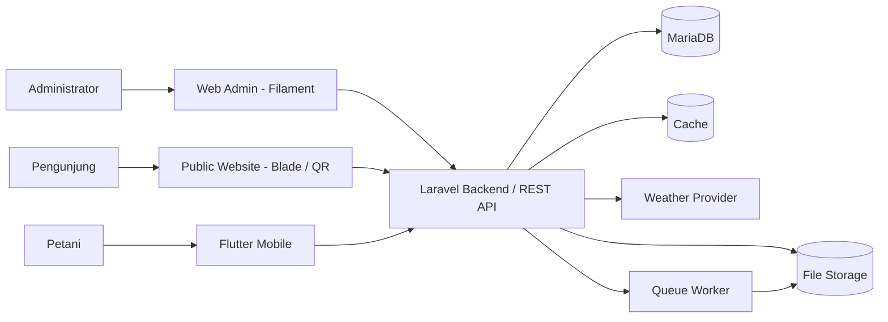

# ARCHITECTURE
## Sistem Informasi Manajemen Perkebunan Durian

- Versi: 1.0 (draft)
- Pola: modular monolith backend + REST API + Flutter offline-first
- Deployment awal: web, API, database, cache, dan storage dapat berada pada satu server sesuai kapasitas; komponen tetap dipisahkan secara logis.

## 1. Prinsip Arsitektur

1. Backend Laravel menjadi sumber kebenaran (source of truth) untuk data online.
2. Web dan mobile menggunakan aturan bisnis backend yang sama.
3. Mobile memiliki database SQLite untuk operasi offline.
4. Semua akses bisnis divalidasi melalui autentikasi, permission, penugasan, dan organisasi.
5. File foto disimpan di file/object storage; database menyimpan metadata dan path.
6. Cache tidak boleh melewati batas organisasi atau otorisasi.
7. Integrasi eksternal harus gagal secara terkontrol.

## 2. Stack

- Laravel 13.43.0 / PHP 8.3.14 (versi proyek yang telah dilaporkan; verifikasi aktual).
- MariaDB 10.4.28 / InnoDB / utf8mb4.
- Filament untuk admin.
- Blade untuk website publik.
- Sanctum untuk API token.
- Flutter/Dart untuk mobile.
- SQLite untuk penyimpanan lokal mobile.
- Laravel Cache; Redis opsional berdasarkan hasil profiling.
- Laravel Queue untuk pekerjaan asynchronous bila diperlukan.

## 3. Diagram Konteks

## 4. Pemisahan Aplikasi Web dan Mobile

Pemisahan dilakukan pada client, route, autentikasi, dan pengalaman pengguna. Keduanya tetap menggunakan satu backend dan database utama.

Contoh deployment (nama host hanya ilustrasi):
- `admin.example.com`: dashboard admin.
- `example.com`: halaman publik.
- `api.example.com/api/v1`: API untuk web dan mobile.

Reverse proxy Nginx/Apache dapat mengarahkan host/path ke aplikasi Laravel yang sama atau deployment terpisah sesuai kebutuhan. Jangan membuat backend bisnis ganda tanpa alasan.

## 5. Lapisan Backend

Rekomendasi tanggung jawab:

- Routes: deklarasi endpoint dan middleware.
- Controllers: menerima request dan mengembalikan response.
- Form Requests: validasi input dan otorisasi tingkat request bila sesuai.
- Services/Actions: orkestrasi proses bisnis.
- Models: relasi dan aturan persistence.
- Policies/permission middleware: otorisasi.
- API Resources: bentuk response yang konsisten.
- Jobs: proses berat/asynchronous.
- Events/Listeners: efek samping seperti invalidasi cache dan notifikasi.
- Tests: unit, feature, integration, security, dan performance.

Hindari controller yang memuat seluruh logika bisnis.

## 6. Multi-Tenancy dan Keamanan Data

- Setiap entitas tenant-owned harus dapat ditelusuri ke organisasi, secara langsung atau melalui relasi induk yang tervalidasi.
- Query harus menerapkan organisasi berdasarkan identitas pengguna yang terautentikasi, bukan semata-mata `organization_id` dari request.
- Untuk akses lintas organisasi, hanya role khusus yang boleh dan seluruh akses harus diaudit.
- Validasi nested relation: misalnya pohon harus berada pada kebun organisasi yang sama.
- Cache key harus menyertakan tenant/context yang sesuai.
- Storage path dan URL privat harus mengikuti organisasi serta permission.
- Job queue harus membawa konteks organisasi dan memvalidasinya kembali saat dijalankan.

## 7. Data Layer

MariaDB adalah database utama. Gunakan InnoDB dan foreign key untuk integritas relasi.

Jenis ID:
- Mayoritas tabel menggunakan UUID CHAR(36), sesuai skema aktual.
- Tabel `audit_logs`, `iot_telemetry`, dan `sync_logs` dilaporkan menggunakan BIGINT UNSIGNED AUTO_INCREMENT.
- Verifikasi tipe setiap tabel dari schema aktual sebelum membuat migration/model baru.

Jangan mengasumsikan kolom, index, nullable, atau cascade behavior. `DATABASE.md` dan schema dump harus menjadi acuan.

## 8. File Storage dan Foto

Alur:
1. Client memilih foto.
2. Backend memvalidasi file.
3. Foto dikompresi/diubah ke format yang disepakati (misalnya WebP jika kompatibel).
4. File disimpan pada storage.
5. Metadata dan path disimpan di MariaDB.
6. API memberikan URL/route akses yang sesuai.

Foto tidak disimpan sebagai BLOB secara default. Gunakan private storage untuk foto yang tidak publik. Siapkan strategi thumbnail, retensi, backup, dan penghapusan file yatim.

## 9. Cache

Cache hanya digunakan untuk data yang manfaatnya terbukti:
- master data yang jarang berubah;
- ringkasan dashboard;
- konfigurasi;
- permission dengan invalidasi yang ketat;
- cuaca sesuai TTL provider.

Jangan cache response sensitif tanpa pemisahan tenant dan user. Setiap write harus memicu invalidasi atau pembaruan cache yang relevan.

## 10. Mobile Offline-First

Flutter menggunakan SQLite untuk:
- master data yang dibutuhkan petani;
- data tugas dan area penugasan;
- draft aktivitas;
- antrean upload foto;
- antrean sinkronisasi.

Setiap perubahan lokal sebaiknya memiliki UUID/client-generated ID, status sync, waktu perubahan, dan metadata versi. Server tetap memvalidasi permission dan relasi.

### Pola sinkronisasi
- Bootstrap: mengunduh data awal sesuai scope pengguna.
- Pull: mengambil perubahan server sejak cursor/waktu sinkronisasi.
- Push: mengirim perubahan lokal yang belum tersinkron.
- Acknowledge: server mengembalikan ID/status/versi.
- Conflict: ditandai dan diselesaikan sesuai kebijakan per entitas.
- Retry: menggunakan backoff dan idempotency agar tidak menggandakan transaksi.

Jangan menggunakan last-write-wins untuk semua jenis data tanpa analisis. Catatan historis umumnya lebih aman sebagai append-only; perubahan master data dapat memakai optimistic concurrency/versioning.

## 11. Integrasi Cuaca dan IoT

Cuaca:
- Provider belum ditetapkan.
- Simpan waktu observasi, lokasi/area, sumber, dan payload yang diperlukan.
- Terapkan timeout, retry terbatas, dan cache sesuai freshness data.

IoT:
- Tabel monitoring area, perangkat, dan telemetry menjadi fondasi.
- MQTT/protokol lain dipilih setelah perangkat dan kebutuhan ditentukan.
- Validasi identitas perangkat dan payload wajib dilakukan sebelum penyimpanan.

## 12. Observability dan Operasional

- Log request dengan correlation/request ID.
- Jangan log token, password, atau data sensitif.
- Pantau P50/P95/P99, error rate, throughput, query lambat, CPU, dan memory.
- Pantau antrean job dan kegagalan sinkronisasi.
- Siapkan backup database dan file storage.
- Uji pemulihan backup.
- Gunakan HTTPS dan konfigurasi production yang aman.

## 13. Deployment

Satu server dapat menjalankan reverse proxy, Laravel, worker, MariaDB, cache, dan storage lokal pada tahap awal, tetapi resource isolation dan backup perlu dipertimbangkan. Untuk pertumbuhan, database, cache, dan object storage dapat dipisahkan tanpa mengubah kontrak API.

## 14. Keputusan yang Masih Terbuka

- Domain dan strategi hosting.
- Redis atau cache driver lain.
- Queue driver dan worker deployment.
- Provider cuaca.
- Object storage provider.
- Kebijakan konflik sync per entitas.
- Strategi backup dan retensi.
- Observability/APM.
