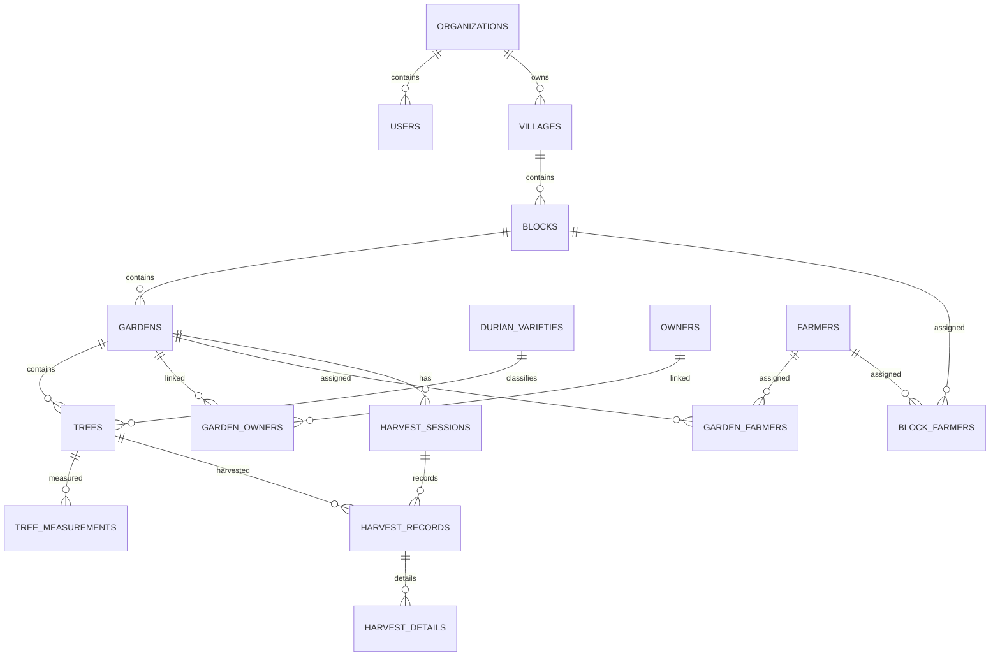

# DATABASE DESIGN
## Sistem Informasi Manajemen Perkebunan Durian

- Versi: 1.0 (logical design)
- Database: MariaDB 10.4.28, InnoDB, utf8mb4
- Nama database proyek: `durian_farm_db`
- Catatan: daftar tabel dan relasi di bawah berasal dari rancangan/struktur yang telah dilaporkan. Kolom lengkap, tipe, index, constraint, dan nullability wajib diverifikasi dari database aktual.

## 1. Prinsip

- Gunakan InnoDB dan foreign key.
- Mayoritas primary key menggunakan UUID CHAR(36), sesuai skema proyek.
- `audit_logs`, `iot_telemetry`, dan `sync_logs` dilaporkan menggunakan BIGINT UNSIGNED AUTO_INCREMENT.
- Gunakan `utf8mb4`.
- Hindari penghapusan historis yang merusak audit.
- Setiap data tenant harus memiliki jalur validasi organisasi.
- Jangan membuat index secara membabi buta; gunakan query nyata dan EXPLAIN.

## 2. Daftar Tabel

### Organisasi dan akses
1. `organizations`
2. `users`
3. `roles`
4. `permissions`
5. `user_roles`
6. `role_permissions`

### Wilayah, kebun, dan orang
7. `owners`
8. `farmers`
9. `villages`
10. `blocks`
11. `gardens`
12. `garden_owners`
13. `garden_farmers`
14. `block_farmers`

### Pohon dan varietas
15. `durian_varieties`
16. `trees`
17. `tree_measurements`

### Aktivitas perkebunan
18. `product_categories`
19. `agricultural_products`
20. `fertilization_records`
21. `fertilization_items`
22. `spraying_records`
23. `spraying_items`
24. `flowering_records`
25. `fruit_development_records`

### Panen
26. `harvest_seasons`
27. `harvest_sessions`
28. `harvest_records`
29. `harvest_details`

### Cuaca, IoT, QR, foto, audit, sinkronisasi
30. `weather_records`
31. `monitoring_areas`
32. `iot_devices`
33. `iot_telemetry`
34. `tree_qr_codes`
35. `activity_photos`
36. `audit_logs`
37. `sync_logs`

## 3. Relasi Konseptual

Diagram bersifat konseptual. Nama entity pada diagram harus disesuaikan bila diperlukan; tabel aktual tetap menggunakan nama dalam daftar.

## 4. Relasi dan Constraint Penting yang Telah Dilaporkan

- `trees` memiliki unique key `(id, garden_id)` untuk mendukung composite foreign key.
- `harvest_sessions` memiliki unique key `(id, garden_id)`.
- `harvest_records` memiliki foreign key komposit:
  - `(session_id, garden_id)` → `harvest_sessions(id, garden_id)`.
  - `(tree_id, garden_id)` → `trees(id, garden_id)`.
- `harvest_details` mengacu ke `harvest_records(id)`.
- `tree_qr_codes.tree_id` bersifat unique (satu baris QR per pohon).
- `activity_photos` menggunakan relasi polymorphic melalui `activity_type` dan `activity_id`; validasi tipe objek harus dilakukan pada aplikasi.

## 5. Aturan Relasi Bisnis

1. Satu desa memiliki banyak blok.
2. Satu blok memiliki banyak kebun.
3. Satu kebun memiliki banyak pohon.
4. Pohon terhubung langsung ke kebun, bukan langsung ke blok.
5. Satu kebun dapat memiliki banyak pemilik.
6. Satu pemilik dapat memiliki banyak kebun.
7. Petani dapat ditugaskan ke banyak blok dan/atau kebun.
8. Satu pohon dapat memiliki banyak riwayat pengukuran.
9. Satu pohon dapat memiliki banyak catatan aktivitas dan panen sesuai model.
10. Satu sesi panen terikat ke kebun.
11. Catatan panen harus memastikan pohon dan sesi berasal dari kebun yang sama.

## 6. Indexing — Panduan Evaluasi

Index kandidat harus ditentukan berdasarkan query aktual. Evaluasi:
- seluruh foreign key;
- kolom tenant/org yang digunakan untuk filter;
- kombinasi tenant + tanggal;
- relasi garden/tree;
- pencarian status dan tanggal aktivitas;
- pagination dengan order yang konsisten.

Contoh pola yang dapat dievaluasi, bukan daftar index otomatis:
- `(organization_id, created_at)`
- `(organization_id, is_active)`
- `(garden_id, created_at)`
- `(tree_id, measured_at)`
- `(garden_id, harvest_date)`

Sebelum menambah index:
1. Periksa index yang sudah ada.
2. Ambil query aktual.
3. Jalankan EXPLAIN.
4. Pertimbangkan urutan kolom dan selektivitas.
5. Ukur biaya write.
6. Buat migration yang aman dan dapat direview.

## 7. Data Foto

Simpan binary foto di file/object storage secara default. Simpan metadata di database, misalnya:
- ID foto.
- Tipe objek dan ID objek.
- Path storage.
- MIME type.
- Ukuran byte.
- Lebar/tinggi.
- Hash/checksum bila diperlukan.
- Waktu upload dan uploader.

Nama kolom final mengikuti schema aktual. Jangan mengarang migration sebelum memeriksa `activity_photos`.

## 8. Audit dan Sinkronisasi

Audit log harus merekam aktor, aksi, objek, waktu, dan perubahan yang aman. Sync log mencatat operasi sinkronisasi dan hasilnya. Hindari menyimpan token atau rahasia.

## 9. Pemeriksaan Skema Aktual

Sebelum mengubah database, ekspor:
- `SHOW CREATE TABLE` untuk seluruh tabel;
- `SHOW INDEX FROM nama_tabel`;
- daftar foreign key;
- tipe data, nullable, default, dan collation.

Bandingkan hasilnya dengan dokumen ini. Jika berbeda, perbarui dokumen berdasarkan database aktual. Jangan menggunakan `migrate:fresh` atau rollback massal pada database utama.
